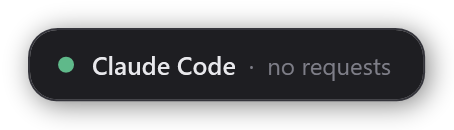
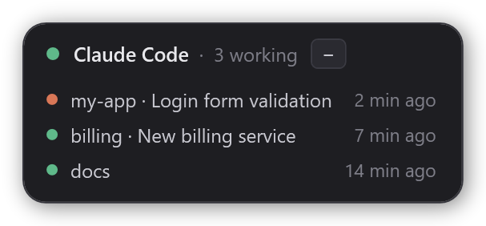
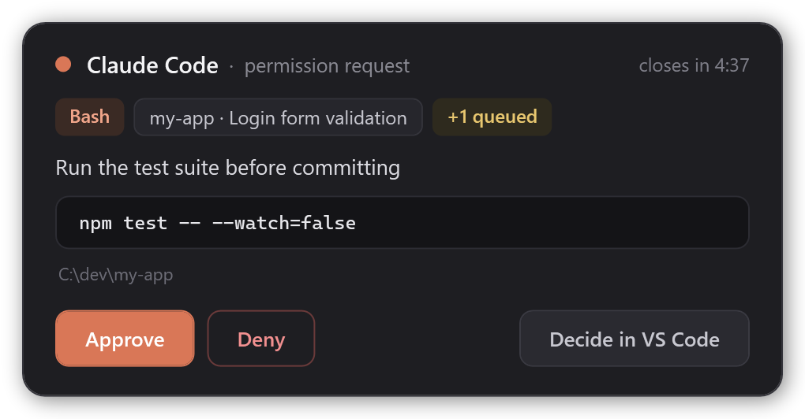
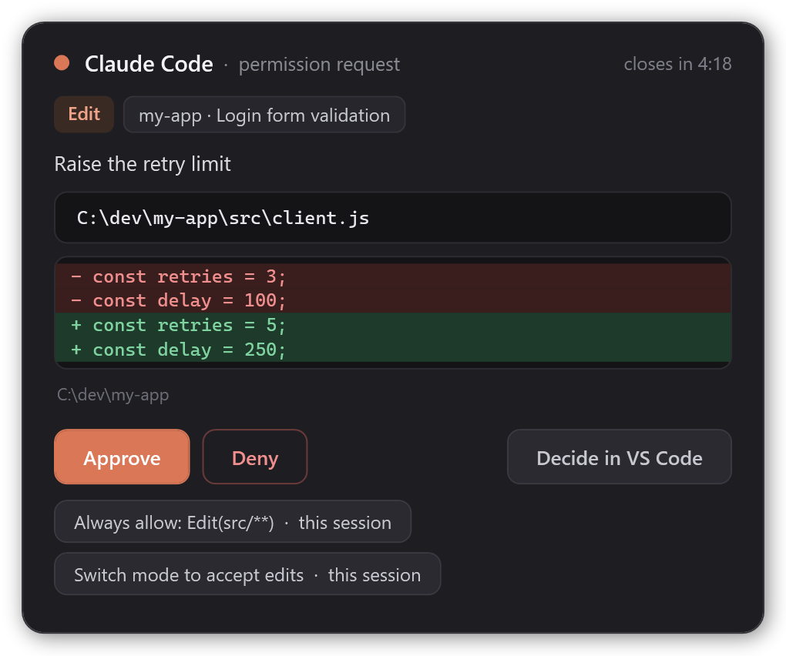
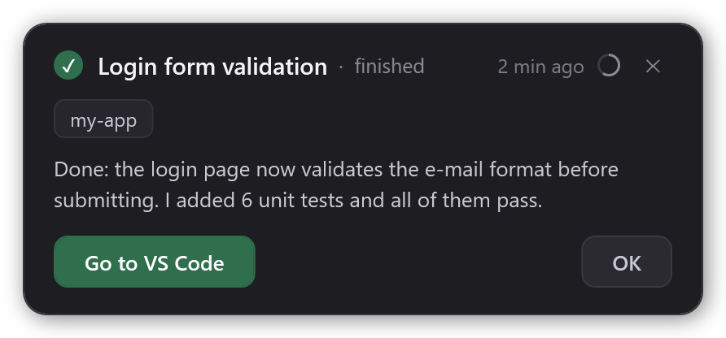
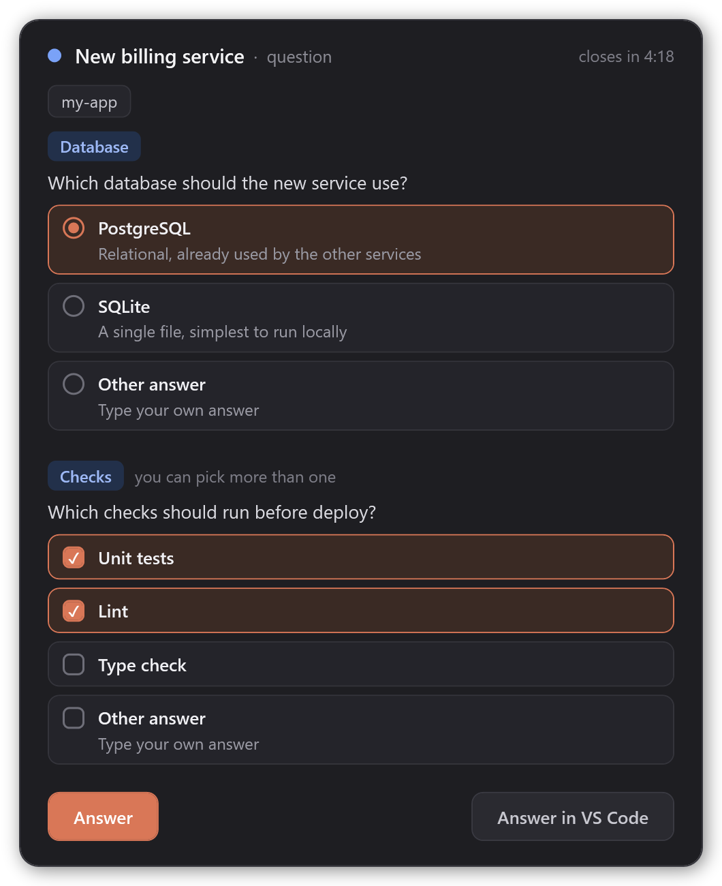
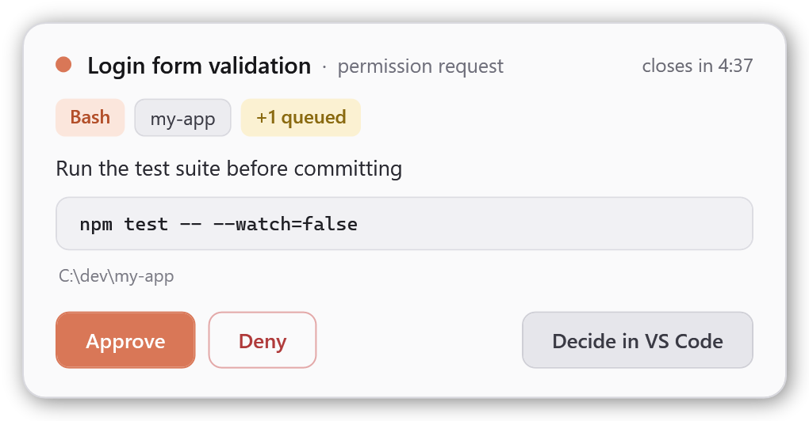

# Claude Code Widget

**English** · [Português](README.pt-BR.md)

An always-on-top desktop widget for [Claude Code](https://code.claude.com) on Windows. Keep working in other windows. When Claude needs you, a small card shows up in the corner of the screen. It never steals focus.

- **Permission requests**: see the tool, the command or file and the project, then click **Approve**, **Deny** or **Decide in VS Code**.
- **Claude's questions** (the multiple-choice ones): pick one or more options, or type your own answer.
- **"Finished" notices**: when Claude finishes a reply, the widget shows the project and the start of the reply, plus a button that takes you back to that session's window: VS Code, the terminal or the Claude desktop app. Notices from several sessions stack, one box each, and each closes by itself after 5 minutes (you can change that).
- **Telegram alerts** (optional): if a request, a question or a "finished" notice waits too long, or you are away, the widget sends you a message on your phone. See [Telegram alerts](#telegram-alerts).

When there is nothing to show, it shrinks to a small pill that you can drag anywhere:





<table>
  <tr>
    <td valign="top">
      <br>
      <br>
      
    </td>
    <td valign="top">
      
    </td>
  </tr>
</table>

## Requirements

- Windows 10 or 11. The widget uses Windows PowerShell 5.1 and WPF, both built into Windows. It does not run on macOS or Linux.
- Claude Code, either the VS Code extension or the CLI in a terminal (Windows Terminal, PowerShell, cmd). Tested with v2.1.286. Answering questions from the widget needs v2.1.85 or later.
- VS Code is optional. Everything works with the CLI in a terminal too.

## Install

In a terminal:

```powershell
claude plugin marketplace add OPaiva-1721/claude-code-widget
claude plugin install opaiva-code-widget@claude-code-widget
```

You can also run the same commands inside Claude Code: `/plugin marketplace add OPaiva-1721/claude-code-widget`, then `/plugin install opaiva-code-widget@claude-code-widget`.

Then start a new Claude Code session, or run `/reload-plugins`. The widget opens on its own with the first session.

### Update

Coming from version 1.1.1 or earlier? Follow [Renamed in 2.0.0](#renamed-in-200) instead.

```powershell
claude plugin marketplace update claude-code-widget
claude plugin update opaiva-code-widget@claude-code-widget
```

Then start a new Claude Code session. The widget restarts with the new version on its own. See the [changelog](CHANGELOG.md) for what changed.

### Renamed in 2.0.0

Up to version 1.1.1 the plugin was called `claude-code-widget`. Claude Code now reserves plugin names that start with `claude-` for Anthropic's own plugins, so from 2.0.0 on it is `opaiva-code-widget`. The marketplace keeps its name and tells Claude Code about the new one: once the marketplace is updated, the old plugin no longer loads, and Claude Code moves your settings to the new name. Switch once by hand so the new plugin is installed and the old widget is gone:

1. **Uninstall the old plugin first.** With both installed, every request shows up in two widgets. If it says the plugin is not installed, Claude Code already moved it: just continue.

   ```powershell
   claude plugin uninstall claude-code-widget@claude-code-widget
   ```

2. Run `/reload-plugins` in every Claude Code session that is still open, or close them. Open sessions keep the old hooks and would open the old widget again. Then close the old widget: **right-click → Close widget**.
3. Install the new one:

   ```powershell
   claude plugin marketplace update claude-code-widget
   claude plugin install opaiva-code-widget@claude-code-widget
   ```

4. Start a new Claude Code session, or run `/reload-plugins`.

The widget starts in the default corner again, because the new name comes with a new data folder.

## How to use it

| What you see | What to do |
| --- | --- |
| Orange pulsing dot, **permission request** | **Approve** runs the action. **Deny** blocks it and tells Claude you denied it. **Decide in VS Code** shows the normal prompt in VS Code. For an **Edit** or **Write** the card shows the diff. **Always allow...** approves and saves the rule shown on the button (this session, this project or all projects); it only offers rules Claude Code itself suggested. |
| Blue pulsing dot, **question** | Pick an option (or several, when the question allows it), then **Answer**. **Other answer** lets you type; Enter also sends it. **Answer in VS Code** hands the question back to VS Code. |
| Green check, **finished** | **Go to VS Code**, **Go to terminal** or **Go to window** brings that session's window to the front. For a Claude desktop app session the button says **Open Claude**: the app keeps every session in one window and has no link to open a given one, so the widget brings the app forward and the button's tooltip names the session to pick in its sidebar. **OK** or **✕** dismisses the notice; the ring next to the ✕ empties until it closes by itself (5 minutes by default, see [Close automatically](#look-and-sound); with **Never** there is no ring). One box per notice, newest on top (up to 4; the last one counts the rest). When the turn ended with a question in the Claude desktop app's "next step" box, the box says **question for you** and shows it (answer it in the app). |
| Idle pill, **N working** | Click it to list the working sessions (project, title, time). Click again to close the list. |

- **Drag** the widget anywhere, on any monitor. It remembers the position by its top edge: cards and notices grow downwards from there (upwards only when they would not fit), and the widget always stays inside one monitor.
- **Double-click** the widget (outside its buttons) to bring back the session's window: on a "finished" notice, that session; otherwise, the session you typed in last.
- **Right-click** opens the menu: **Theme**, **Opacity**, **Volume**, **Size**, **Minimal pill**, **Close automatically** (see [Look and sound](#look-and-sound)), **Telegram** (see [Telegram alerts](#telegram-alerts)) and **Close widget**. The menu closes when you click anywhere else. Close hands pending requests back to VS Code, and the widget opens again with the next session or request (while "do not disturb" is on it stays hidden).
- **Tray icon.** Left-click toggles **do not disturb**; right-click for the menu. In the mode, requests and questions go straight to VS Code, the widget is hidden and "finished" notices wait until you turn it off. It stays on until you turn it off, even after a restart. Windows may hide new tray icons: drag it onto the taskbar once.
- With several requests, a chip shows how many are waiting (`+1 queued`), and they come one at a time, before any "finished" notice.
- The project chip also shows the session's title (the name from `/rename`, or Claude Code's automatic one). When several sessions were working and the last one finishes, its notice plays a different sound.

## Behavior worth knowing

- **It never takes focus.** You keep typing wherever you were, even while you click its buttons. The only exception is **Other answer**: the widget takes focus so you can type, then gives it back.
- **Cards close by themselves.** If nobody answers, the card closes after the **Close automatically** time (5 minutes by default) and the request goes to VS Code as usual. With **Never**, the card stays until you answer it, you go away or 60 minutes pass, and it shows no countdown.
- **Away from the computer.** With no mouse or keyboard input for 5 minutes, requests and questions skip the widget and go straight to VS Code. This also applies to a card already on screen. If you use [Remote Control](https://code.claude.com/docs/en/remote-control), that is how they reach your phone or browser without delay. With Telegram connected, the alert goes out at that moment.
- **Monitor changes.** If the widget's monitor goes away (say, you undock the laptop), the widget moves to the main screen's bottom-right corner within a couple of seconds. When that monitor is back, it returns to where you put it.
- **No "finished" notice while you watch.** When you send a message, the widget remembers the window you typed in, VS Code or a terminal. If that window is in front when Claude finishes, no notice is shown. In Windows Terminal this works per window, not per tab. The Claude desktop app is the exception: one window holds all its sessions, so its notices always show. The notice also disappears when you send a new message in that session, and after the **Close automatically** time (5 minutes by default; with **Never**, when you close it, or after 12 hours).
- **A notice closes when you look at it.** If a notice is already on screen and you bring that session's window to the front, the notice closes, as if you had clicked **OK**. This does not apply to the Claude desktop app, for the same reason as above.
- **Plan approval stays in VS Code.** Approving a plan (`ExitPlanMode`) is never routed to the widget. With Telegram connected, it can still alert you if you are away.
- **What it can't do:** send new prompts. Claude Code has no supported way to inject messages into a running VS Code session. For that, use Remote Control.

## Telegram alerts

Off until you connect it. When something waits and you are not looking, the widget sends a message to your phone through a Telegram bot of your own. It only alerts: you cannot approve or answer from Telegram (for that, use [Remote Control](https://code.claude.com/docs/en/remote-control)).

**Connect it** from the widget: right-click → **Telegram** → **Connect Telegram…**. A card walks you through 3 steps:

1. **Create your bot.** The **Open BotFather** button opens it in Telegram. Send `/newbot`, pick a name, copy the token and paste it in the widget.
2. **Tell your bot it's you.** Press **Open my bot in Telegram** and then Start. The widget finds your chat by itself with a one-time code, so you never look up a chat id, and nobody else who writes to the bot can take your place. No Telegram on this PC? The card also shows the `/start` message to send to your bot from your phone.
3. **Connected.** The widget sends a test message and turns **Alerts on**.

A bot that already has a webhook (or another program reading its messages) cannot be used: create a new one with `/newbot`.

When it sends a message:

| Situation | Telegram |
| --- | --- |
| A permission request or question waits unanswered for **Alert after** (1, 3 or 5 minutes; default 5) | A message at that moment. The card stays on screen if you are at the computer. If you are away, it goes back to VS Code right then, so Remote Control can answer it. |
| You are away (no input for 5 minutes) and a request skips the widget, or you go away while its card is on screen | A message right away. |
| A "finished" notice is still open at **Alert after** | A message. If the notice closes by itself sooner, the message goes out up to 15 seconds before. For a Claude desktop app session, only if you are away at that moment. Only then: a notice that stays open longer does not alert later, for example when you step away or after you turn Alerts on. |
| A request waits in VS Code (plan approval, **Decide in VS Code**, do not disturb, widget not running) | A message once it has waited **Alert after** and you are away. |
| You answered, the notice closed or you looked at its window in time | None. |

- **Do not disturb** silences the widget, not the phone: with it on, Telegram only fires when you are away.
- Alerts that fall within a few seconds of each other go in one message.
- Turning **Alerts on** (or connecting) never sends what was queued while alerts were off.
- When the session moves on (you answered in VS Code, Claude went on, a new prompt), the message is edited to **✅ resolved**, so an old alert on your phone does not look pending.
- The message has the project, the session title and what is waiting: the tool and the command or file (cut to about 200 characters), the question, or the start of the reply. Never the token, the diff or a whole file.
- **Alert after** only decides when the message goes out. How long a card or a notice stays on screen is **Close automatically**.

The **Telegram** menu has **Alerts on** (a check), **Alert after** (1, 3 or 5 minutes), **Send test** and **Disconnect** once connected.

## Settings

Set these environment variables in the `env` block of `~/.claude/settings.json`. The widget reads that block itself when it starts, so they apply even though a hook starts the widget (up to 2.6.x a widget started that way could miss them):

| Variable | Default | What it does |
| --- | --- | --- |
| `CLAUDE_WIDGET_LANG` | Windows display language | `pt`, `es` or `en`. Any other value falls back to English. |
| `CLAUDE_WIDGET_AWAY_SECS` | `300` | Seconds without mouse or keyboard input before requests skip the widget. |
| `CLAUDE_WIDGET_HOTKEYS` | off | `1` turns on the global hotkeys. While on, those key combinations stop working in other programs, and Approve/Deny act on the permission card on screen without you looking at it. |
| `CLAUDE_WIDGET_KEY_APPROVE` | `Ctrl+Alt+Y` | Hotkey that approves the permission card on screen. |
| `CLAUDE_WIDGET_KEY_DENY` | `Ctrl+Alt+N` | Hotkey that denies it. |
| `CLAUDE_WIDGET_KEY_DND` | `Ctrl+Alt+D` | Hotkey that turns "do not disturb" on and off. |

The hotkey variables are read when the widget starts, so restart it after changing them (it restarts by itself with the next plugin update). Keys like AltGr combinations may not work as hotkeys. In the "Always allow" buttons, **only here (local)** means `.claude/settings.local.json`; a destination Claude Code adds in the future is shown as it is.

```json
{
  "env": {
    "CLAUDE_WIDGET_LANG": "en"
  }
}
```

## Look and sound

Right-click the widget to change how it looks and sounds. Each choice applies right away and is saved in `prefs.json` in the plugin data folder.

You can also edit it by hand (restart the widget afterwards): `{"theme":"dark","opacity":1,"volume":100,"scale":1,"minimal":false,"closeAfter":5,"notifyAfter":5,"telegram":false}`. `theme` is `dark`, `light` or `auto`; `opacity` goes from 0.5 to 1; `volume` from 0 to 100; `scale` is 1, 1.25 or 1.5; `minimal` is true or false; `closeAfter` is 1, 3, 5, 15, 30 or 0 (never); `notifyAfter` is 1, 3 or 5; `telegram` is true or false. A missing or invalid value falls back to the default.

| Menu | Choices |
| --- | --- |
| Theme | Dark (default), Light, or Automatic (follows the Windows app theme when the widget opens) |
| Opacity | 100, 90, 80, 70 or 60% |
| Volume | Mute, 25, 50, 75 or 100% (default) |
| Size | 100% (default), 125% or 150% |
| Minimal pill | When idle, shows only the colored dot. The status text becomes the tooltip, and a click still opens the sessions list. |
| Close automatically | 1, 3, 5 (default), 15 or 30 minutes, or Never. Applies to cards (requests and questions) and to "finished" notices. With Never, a card stays until you answer, you go away or 60 minutes pass; a notice stays until you close it or look at its window (12 hours at most). There is no countdown with Never. |
| Telegram | Connect, alerts on or off, Alert after, test and disconnect: see [Telegram alerts](#telegram-alerts). |



The volume applies to the widget's three sounds (request, finished, all done). If Windows cannot play a sound file, the widget falls back to the system sound, which ignores the volume setting (Mute still silences it).

The Minecraft theme of 2.5.x was removed in 2.6.0, so the widget no longer downloads anything. A `prefs.json` that still says `minecraft` falls back to the dark theme, and you can delete the leftover `minecraft` folder in the plugin data folder.

## How it works

```
Claude Code ──hook──▶ hook.ps1 ──queue\req-<id>.json──▶ widget.ps1 (WPF, always on top)
            ◀─JSON──           ◀──queue\res-<id>.json──
```

- `hook.ps1` runs on six hook events. On `PermissionRequest` and on `PreToolUse` for `AskUserQuestion`, it writes a request file and waits for the widget's answer. Then it prints the decision in Claude Code's hook format. On `Stop` it writes a "finished" notice, and on `UserPromptSubmit` it clears it. On `UserPromptSubmit` it also remembers the window in front, but only if the process tree shows it belongs to that Claude Code session. A prompt sent from your phone leaves an unrelated window in front, so it is ignored. On `SessionStart` it only makes sure the widget is running. On `Notification` (Claude Code saying it waits for a permission or an answer) it only notes that the session waits in VS Code, for the Telegram alerts. It also keeps track of which sessions are working (`busy\`), to tell when the last one of several finishes. With Telegram connected it also leaves small files in the queue for the widget to send; the hook itself never uses the network.
- `widget.ps1` is a single long-running process, one per user. It is started outside Claude Code's process tree, so it survives the end of a session. It polls the queue folder and shows the oldest item first. It also sends the Telegram alerts, in the background, so the window never waits for the network.
- `common.ps1` holds the helpers both scripts share: the widget's mutex name, atomic JSON writes, the UI language and the queue readers.
- `telegram.ps1` is the Telegram Bot API client, and the only file that uses the network.
- Files live in the plugin data folder, `%USERPROFILE%\.claude\plugins\data\opaiva-code-widget-claude-code-widget\`: the queue, each session's window (`sessions\`), the sessions working now (`busy\`, `busy-round.json`), the "do not disturb" mode (`dnd.flag`), the widget position (`state.json`) and logs (`hook.log`, `widget.log`; each keeps up to 256 KB, plus one `.old` file). Telegram adds `telegram.json` (the connection, with the token encrypted), `telegram-sent.json` (which alerts went out, and their message ids, to mark them resolved) and, in the queue folder, the alerts to send (`tg-*`) and per session, `wait-*` (waiting in VS Code), `seen-*` (the session moved on) and `alerted-*` (an alert was queued for it). None of them is written until Telegram is connected.

## Security

- Approving in the widget is the same as clicking **Allow** in VS Code. The widget shows the full command or file path before you decide.
- **Always allow** saves a permanent rule: the button shows the rule and where it goes, and the widget only saves rules Claude Code itself suggested for that request (never rules that remove yours, nor "bypass permissions").
- Without Telegram, everything stays on your machine. There is no telemetry and no network use. The only data are files in the plugin data folder, inside your user profile.
- Only if you connect Telegram does the widget use the network, and only to `api.telegram.org`. Only `telegram.ps1` does it (a repository test checks this), and the hook never touches the network. The messages go through Telegram and carry the project, the session title and what is waiting (see [Telegram alerts](#telegram-alerts)). **Disconnect** deletes the connection.
- The bot token is saved in `telegram.json`, encrypted with Windows DPAPI for your Windows user: another user, or another PC, cannot read it. It is never written to `prefs.json`, to the logs or to a message.
- Requests and answers are plain files that only your Windows user can write. A program running as you could write an answer file, but such a program could already do anything you can.
- Plan approvals and anything you don't answer always fall back to Claude Code's own prompt.

## Troubleshooting

- **The widget doesn't show up.** Start a new session, or run `/reload-plugins`, and check `claude plugin list`. Then look at `widget.log` in the data folder.
- **Requests still only show up in VS Code.** Check `hook.log`. Every event writes a line there, such as `PermissionRequest 1a2b3c4d Bash -> allow`. If nothing new appears, the hooks are not loaded.
- **Text appears as `?` or broken accents.** Make sure the `.ps1` files weren't re-saved with a different encoding. They must stay ASCII-only, and the UI text lives in `strings.json` (UTF-8).

## Uninstall

```powershell
claude plugin uninstall opaiva-code-widget@claude-code-widget
```

The running widget doesn't know the plugin was removed, so close it with **right-click → Close widget**, or sign out of Windows.

## Development

- Validate the plugin and the marketplace: `claude plugin validate .` and `claude plugin validate plugins/opaiva-code-widget`.
- Run the tests: install [Pester](https://pester.dev) 5.5 or later once with `Install-Module Pester -MinimumVersion 5.5 -Scope CurrentUser -Force -SkipPublisherCheck`, then run `powershell -NoProfile -File tools\test.ps1`. One test shows a widget in the corner of the screen for a few seconds (the tests start widgets without a tray icon, through `CLAUDE_WIDGET_NO_TRAY=1`); add `-ExcludeTag Desktop` to skip the tests that run the real widget. GitHub Actions runs the same suite on every push and pull request.
- Regenerate the README images from the real widget code: `powershell -NoProfile -File tools\render-screenshots.ps1`. Sample data lives in `tools/samples.json`. It also renders the Telegram setup steps, but the README does not use them, so the script deletes them.
- Bump `version` in `plugins/opaiva-code-widget/.claude-plugin/plugin.json` for every release. Installed copies stay on the old version until the number changes.

## License

[MIT](LICENSE)
