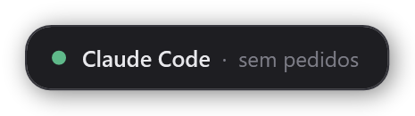
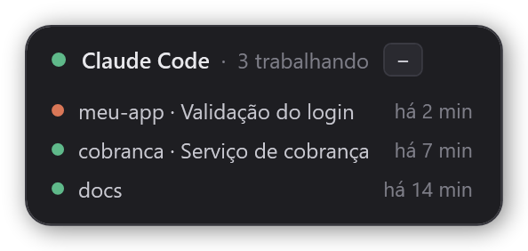
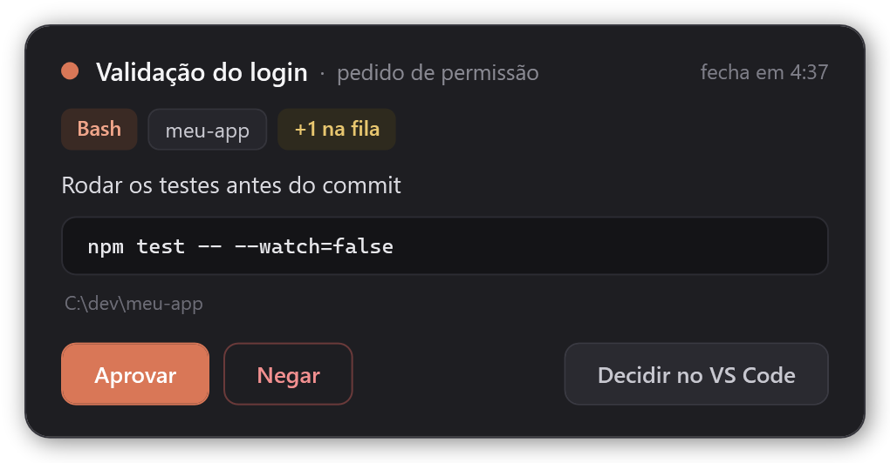
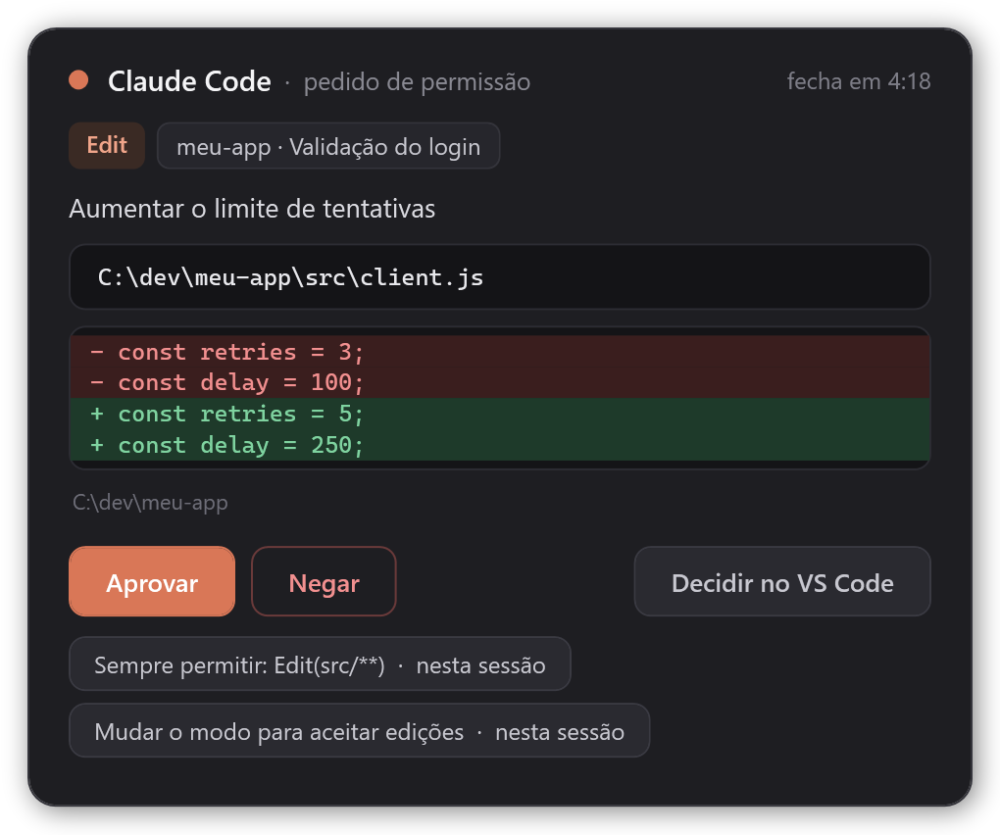
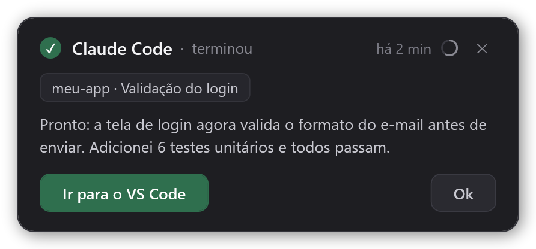
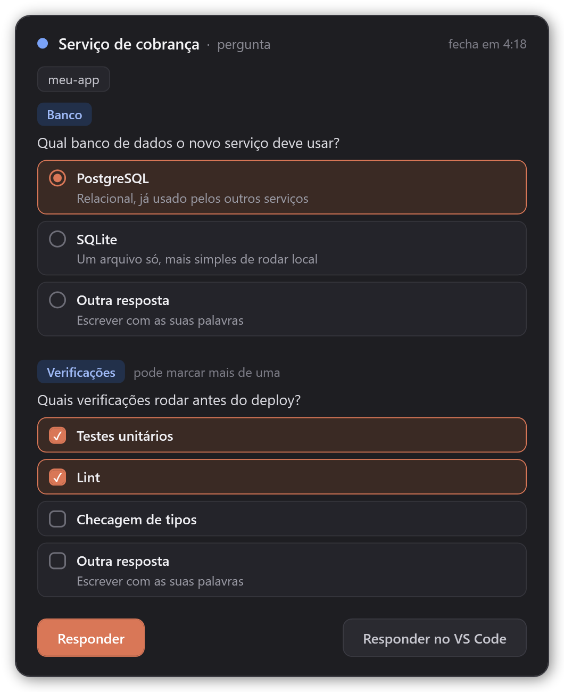
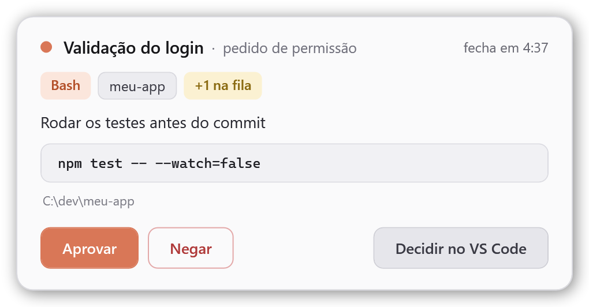

# Claude Code Widget

[English](README.md) · **Português**

Um widget para o [Claude Code](https://code.claude.com) no Windows que fica sempre por cima das outras janelas. Você continua trabalhando onde estiver. Quando o Claude precisa de você, aparece um cartão pequeno no canto da tela, sem tirar o foco da sua janela.

- **Pedidos de permissão**: mostra a ferramenta, o comando ou arquivo e o projeto, com os botões **Aprovar**, **Negar** e **Decidir no VS Code**.
- **Perguntas do Claude** (as de múltipla escolha): você marca uma ou várias opções, ou escreve a sua resposta.
- **Aviso de "terminou"**: quando o Claude termina uma resposta, o widget mostra o projeto e o começo da resposta, com um botão que leva de volta para a janela daquela sessão: VS Code, terminal ou o app desktop do Claude. Avisos de várias sessões se empilham, um cartão por aviso, e cada um fecha sozinho depois de 5 minutos (dá para mudar).
- **Alertas no Telegram** (opcional): se um pedido, uma pergunta ou um aviso de "terminou" esperar demais, ou se você estiver longe, o widget manda uma mensagem para o seu celular. Veja [Alertas no Telegram](#alertas-no-telegram).

Quando não há nada para mostrar, ele vira uma pílula pequena, que dá para arrastar para qualquer canto:





<table>
  <tr>
    <td valign="top">
      <br>
      <br>
      
    </td>
    <td valign="top">
      
    </td>
  </tr>
</table>

## Requisitos

- Windows 10 ou 11. O widget usa o Windows PowerShell 5.1 e o WPF, que já vêm no Windows. Não roda em macOS nem Linux.
- Claude Code, pela extensão do VS Code ou pelo terminal (Windows Terminal, PowerShell, cmd). Testado na versão 2.1.286. Responder perguntas pelo widget exige a versão 2.1.85 ou mais nova.
- O VS Code é opcional. Tudo funciona também com o Claude Code no terminal.

## Instalação

Num terminal:

```powershell
claude plugin marketplace add OPaiva-1721/claude-code-widget
claude plugin install opaiva-code-widget@claude-code-widget
```

Também dá para rodar os mesmos comandos dentro do Claude Code: `/plugin marketplace add OPaiva-1721/claude-code-widget` e depois `/plugin install opaiva-code-widget@claude-code-widget`.

Depois, abra uma sessão nova do Claude Code ou rode `/reload-plugins`. O widget abre sozinho junto com a primeira sessão.

### Atualizar

Vindo da versão 1.1.1 ou anterior? Siga [Renomeado na 2.0.0](#renomeado-na-200) em vez disto.

```powershell
claude plugin marketplace update claude-code-widget
claude plugin update opaiva-code-widget@claude-code-widget
```

Depois, abra uma sessão nova do Claude Code. O widget reinicia sozinho com a versão nova. O que mudou em cada versão está no [changelog](CHANGELOG.md), em inglês.

### Renomeado na 2.0.0

Até a versão 1.1.1 o plugin se chamava `claude-code-widget`. O Claude Code agora reserva os nomes de plugin que começam com `claude-` para os plugins da própria Anthropic, então a partir da 2.0.0 ele se chama `opaiva-code-widget`. O marketplace continua com o mesmo nome e avisa o Claude Code sobre o nome novo: depois que o marketplace é atualizado, o plugin antigo deixa de carregar e o Claude Code passa as suas configurações para o nome novo. Faça a troca uma vez à mão, para o plugin novo ficar instalado e o widget antigo sumir:

1. **Desinstale o plugin antigo primeiro.** Com os dois instalados, cada pedido aparece em dois widgets. Se ele disser que o plugin não está instalado, o Claude Code já fez a troca: é só continuar.

   ```powershell
   claude plugin uninstall claude-code-widget@claude-code-widget
   ```

2. Rode `/reload-plugins` em todas as sessões do Claude Code que ainda estão abertas, ou feche essas sessões. Sessões abertas continuam com os hooks antigos e abririam o widget antigo de novo. Depois feche o widget antigo: **botão direito → Fechar widget**.
3. Instale o novo:

   ```powershell
   claude plugin marketplace update claude-code-widget
   claude plugin install opaiva-code-widget@claude-code-widget
   ```

4. Abra uma sessão nova do Claude Code ou rode `/reload-plugins`.

O widget volta a abrir no canto padrão, porque o nome novo vem com uma pasta de dados nova.

## Como usar

| O que aparece | O que fazer |
| --- | --- |
| Ponto laranja piscando, **pedido de permissão** | **Aprovar** executa a ação. **Negar** bloqueia e avisa o Claude que você negou. **Decidir no VS Code** mostra o pedido normal no VS Code. Num **Edit** ou **Write**, o cartão mostra o diff. **Sempre permitir...** aprova e grava a regra do botão (nesta sessão, neste projeto ou em todos os projetos); só oferece regras que o próprio Claude Code sugeriu. |
| Ponto azul piscando, **pergunta** | Marque uma opção (ou várias, quando a pergunta permite) e clique em **Responder**. **Outra resposta** deixa você digitar; o Enter também envia. **Responder no VS Code** devolve a pergunta para o VS Code. |
| ✓ verde, **terminou** | **Ir para o VS Code**, **Ir para o terminal** ou **Ir para a janela** traz para a frente a janela daquela sessão. **Ok** ou **✕** fecha o aviso; o anel ao lado do ✕ esvazia até ele fechar sozinho (5 minutos por padrão, veja [Fechar automaticamente](#aparência-e-som); com **Nunca** não há anel). Um cartão por aviso, o mais novo em cima (até 4; o último conta os demais). Quando a vez terminou com uma pergunta na caixa de "próximo passo" do app desktop do Claude, o cartão diz **pergunta para você** e mostra a pergunta (responda no app). |
| Pílula parada, **N trabalhando** | Clique para listar as sessões que estão trabalhando (projeto, título, tempo). Clique de novo para fechar a lista. |

- **Arraste** o widget para onde quiser, em qualquer monitor. Ele lembra a posição pela borda de cima: cartões e avisos crescem para baixo a partir dali (para cima só quando não cabem), e o widget fica sempre dentro de um monitor.
- **Duplo clique** no widget (fora dos botões) traz a janela da sessão: no aviso de "terminou", a daquela sessão; nos outros casos, a da última sessão em que você digitou.
- **Botão direito** abre o menu: **Tema**, **Opacidade**, **Volume**, **Tamanho**, **Pílula mínima**, **Fechar automaticamente** (veja [Aparência e som](#aparência-e-som)), **Telegram** (veja [Alertas no Telegram](#alertas-no-telegram)) e **Fechar widget**. O menu fecha quando você clica em qualquer outro lugar. Fechar devolve os pedidos pendentes ao VS Code, e o widget abre de novo na próxima sessão ou no próximo pedido (com o "não perturbe" ligado, ele continua escondido).
- **Ícone na bandeja.** O clique esquerdo liga e desliga o **não perturbe**; o botão direito abre o menu. No modo, pedidos e perguntas vão direto para o VS Code, o widget fica escondido e os avisos de "terminou" esperam até você desligar. Fica ligado até você desligar, inclusive depois de reiniciar. O Windows pode esconder ícones novos na bandeja: arraste-o para a barra uma vez.
- Com vários pedidos, aparece quantos estão esperando (`+1 na fila`), e eles vêm um de cada vez, antes de qualquer aviso de "terminou".
- O chip do projeto também mostra o título da sessão (o nome dado com `/rename`, ou o automático do Claude Code). Quando várias sessões estavam trabalhando e a última termina, o aviso toca um som diferente.

## Comportamentos importantes

- **Nunca tira o foco.** Você continua digitando onde estava, mesmo quando clica nos botões. A única exceção é a **Outra resposta**: o widget pega o foco para você digitar e depois devolve.
- **Os cartões fecham sozinhos.** Se ninguém responder, o cartão fecha depois do tempo de **Fechar automaticamente** (5 minutos por padrão) e o pedido vai para o VS Code normalmente. Com **Nunca**, o cartão fica até você responder, você se afastar ou passarem 60 minutos, e não mostra contagem regressiva.
- **Longe do computador.** Sem uso de mouse nem teclado por 5 minutos, pedidos e perguntas não passam pelo widget e vão direto para o VS Code. Isso vale também para um cartão que já estava na tela. Se você usa o [Remote Control](https://code.claude.com/docs/en/remote-control), é assim que eles chegam no celular ou no navegador sem atraso. Com o Telegram conectado, o alerta sai nesse momento.
- **Troca de monitor.** Se o monitor do widget some (por exemplo, quando você tira o notebook da dock), o widget vai para o canto inferior direito da tela principal em até 2 segundos. Quando o monitor volta, ele volta para onde você tinha colocado.
- **Sem aviso de "terminou" enquanto você está olhando.** Quando você manda uma mensagem, o widget guarda a janela onde você digitou: VS Code ou terminal. Se essa janela estiver na frente quando o Claude terminar, o aviso não aparece. No Windows Terminal isso vale por janela, não por aba. O app desktop do Claude é a exceção: uma janela só reúne todas as sessões, então os avisos dele sempre aparecem. O aviso também some quando você manda uma mensagem nova naquela sessão, e depois do tempo de **Fechar automaticamente** (5 minutos por padrão; com **Nunca**, quando você o fecha, ou depois de 12 horas).
- **O aviso fecha quando você olha para ele.** Se um aviso já está na tela e você traz a janela daquela sessão para a frente, o aviso fecha, como se você tivesse clicado em **Ok**. Isso não vale para o app desktop do Claude, pelo mesmo motivo de cima.
- **Aprovação de plano fica no VS Code.** Aprovar um plano (`ExitPlanMode`) nunca passa pelo widget. Com o Telegram conectado, ele ainda pode avisar você se estiver longe.
- **O que ele não faz:** mandar prompts novos. O Claude Code não tem um jeito suportado de enviar mensagens para uma sessão aberta no VS Code. Para isso, use o Remote Control.

## Alertas no Telegram

Desligados até você conectar. Quando algo espera e você não está olhando, o widget manda uma mensagem para o seu celular por um bot do Telegram que é seu. Ele só avisa: você não consegue aprovar nem responder pelo Telegram (para isso, use o [Remote Control](https://code.claude.com/docs/en/remote-control)).

**Conecte** pelo widget: botão direito → **Telegram** → **Conectar o Telegram…**. Um cartão guia você em 3 passos:

1. **Crie o seu bot.** O botão **Abrir o BotFather** abre o BotFather no Telegram. Envie `/newbot`, escolha um nome, copie o token e cole no widget.
2. **Diga ao seu bot que é você.** Clique em **Abrir meu bot no Telegram** e toque em Iniciar. O widget encontra o seu chat sozinho com um código de uso único, então você nunca procura um chat id, e ninguém que escreva para o bot consegue tomar o seu lugar. Sem Telegram neste PC? O cartão também mostra a mensagem `/start` para enviar ao seu bot pelo celular.
3. **Conectado.** O widget manda uma mensagem de teste e liga os **Alertas**.

Um bot que já tem um webhook (ou outro programa lendo as mensagens dele) não serve: crie um novo com `/newbot`.

Quando ele manda uma mensagem:

| Situação | Telegram |
| --- | --- |
| Um pedido de permissão ou uma pergunta espera sem resposta por **Alertar após** (1, 3 ou 5 minutos; padrão 5) | Uma mensagem nesse momento. O cartão continua na tela se você está no computador. Se você está longe, ele volta para o VS Code na hora, para o Remote Control poder responder. |
| Você está longe (sem uso por 5 minutos) e um pedido não passa pelo widget, ou você se afasta com o cartão na tela | Uma mensagem na hora. |
| Um aviso de "terminou" ainda está aberto em **Alertar após** | Uma mensagem. Se o aviso fechar sozinho antes, a mensagem sai até 15 segundos antes. Numa sessão do app desktop do Claude, só se você estiver longe nesse momento. Só nesse momento: um aviso que fica aberto mais tempo não alerta depois, por exemplo quando você se afasta ou depois de ligar os Alertas. |
| Um pedido espera no VS Code (aprovação de plano, **Decidir no VS Code**, não perturbe, widget fechado) | Uma mensagem quando ele esperou **Alertar após** e você está longe. |
| Você respondeu, o aviso fechou ou você olhou para a janela dele a tempo | Nenhuma. |

- O **não perturbe** silencia o widget, não o celular: com ele ligado, o Telegram só dispara quando você está longe.
- Alertas que caem com poucos segundos de diferença vão numa só mensagem.
- Ligar os **Alertas** (ou conectar) nunca envia o que ficou na fila enquanto eles estavam desligados.
- Quando a sessão segue em frente (você respondeu no VS Code, o Claude continuou, um prompt novo), a mensagem é editada para **✅ resolvido**, para um alerta antigo no celular não parecer pendente.
- A mensagem traz o projeto, o título da sessão e o que está esperando: a ferramenta e o comando ou arquivo (cortado em cerca de 200 caracteres), a pergunta, ou o começo da resposta. Nunca o token, o diff nem um arquivo inteiro.
- **Alertar após** só decide quando a mensagem sai. Quanto tempo um cartão ou um aviso fica na tela é o **Fechar automaticamente**.

Depois de conectado, o menu **Telegram** tem **Alertas ligados** (com marca), **Alertar após** (1, 3 ou 5 minutos), **Enviar teste** e **Desconectar**.

## Configuração

Defina estas variáveis de ambiente no bloco `env` do `~/.claude/settings.json`. O widget lê esse bloco sozinho quando inicia, então elas valem mesmo com o widget aberto por um hook (até a 2.6.x, um widget aberto assim podia não vê-las):

| Variável | Padrão | O que faz |
| --- | --- | --- |
| `CLAUDE_WIDGET_LANG` | idioma do Windows | `pt`, `es` ou `en`. Qualquer outro valor usa inglês. |
| `CLAUDE_WIDGET_AWAY_SECS` | `300` | Segundos sem uso de mouse nem teclado até os pedidos deixarem de passar pelo widget. |
| `CLAUDE_WIDGET_HOTKEYS` | desligado | `1` liga os atalhos globais. Enquanto ligados, essas combinações deixam de funcionar nos outros programas, e Aprovar/Negar agem no cartão de permissão que estiver na tela, sem você olhar. |
| `CLAUDE_WIDGET_KEY_APPROVE` | `Ctrl+Alt+Y` | Atalho que aprova o cartão de permissão na tela. |
| `CLAUDE_WIDGET_KEY_DENY` | `Ctrl+Alt+N` | Atalho que nega. |
| `CLAUDE_WIDGET_KEY_DND` | `Ctrl+Alt+D` | Atalho que liga e desliga o "não perturbe". |

As variáveis de atalho são lidas quando o widget inicia; reinicie-o depois de mudar (ele reinicia sozinho na próxima atualização do plugin). Combinações com AltGr podem não funcionar como atalho. Nos botões "Sempre permitir", **só aqui (local)** quer dizer `.claude/settings.local.json`; um destino que o Claude Code criar no futuro aparece como veio.

```json
{
  "env": {
    "CLAUDE_WIDGET_LANG": "pt"
  }
}
```

## Aparência e som

Clique com o botão direito no widget para mudar como ele parece e soa. Cada escolha vale na hora e fica salva em `prefs.json`, na pasta de dados do plugin.

Você também pode editá-lo à mão (reinicie o widget depois): `{"theme":"dark","opacity":1,"volume":100,"scale":1,"minimal":false,"closeAfter":5,"notifyAfter":5,"telegram":false}`. `theme` é `dark`, `light` ou `auto`; `opacity` vai de 0,5 a 1; `volume` de 0 a 100; `scale` é 1, 1,25 ou 1,5; `minimal` é true ou false; `closeAfter` é 1, 3, 5, 15, 30 ou 0 (nunca); `notifyAfter` é 1, 3 ou 5; `telegram` é true ou false. Um valor ausente ou inválido volta ao padrão.

| Menu | Opções |
| --- | --- |
| Tema | Escuro (padrão), Claro ou Automático (segue o tema de aplicativos do Windows quando o widget abre) |
| Opacidade | 100, 90, 80, 70 ou 60% |
| Volume | Mudo, 25, 50, 75 ou 100% (padrão) |
| Tamanho | 100% (padrão), 125% ou 150% |
| Pílula mínima | Parado, mostra só o ponto colorido. O texto de estado vira dica (tooltip) e o clique ainda abre a lista de sessões. |
| Fechar automaticamente | 1, 3, 5 (padrão), 15 ou 30 minutos, ou Nunca. Vale para os cartões (pedidos e perguntas) e para os avisos de "terminou". Com Nunca, um cartão fica até você responder, se afastar ou passarem 60 minutos; um aviso fica até você fechá-lo ou olhar para a janela dele (12 horas no máximo). Com Nunca não há contagem regressiva. |
| Telegram | Conectar, alertas ligados ou desligados, Alertar após, teste e desconectar: veja [Alertas no Telegram](#alertas-no-telegram). |



O volume vale para os três sons do widget (pedido, terminou, tudo pronto). Se o Windows não conseguir tocar um arquivo de som, o widget usa o som do sistema, que ignora o volume (o Mudo continua silenciando).

O tema Minecraft da 2.5.x foi removido na 2.6.0, então o widget não baixa mais nada. Um `prefs.json` que ainda diga `minecraft` volta ao tema escuro, e você pode apagar a pasta `minecraft` que sobrou na pasta de dados do plugin.

## Como funciona

```
Claude Code ──hook──▶ hook.ps1 ──queue\req-<id>.json──▶ widget.ps1 (WPF, sempre por cima)
            ◀─JSON──           ◀──queue\res-<id>.json──
```

- O `hook.ps1` roda em seis eventos de hook. No `PermissionRequest` e no `PreToolUse` do `AskUserQuestion`, ele grava um arquivo de pedido e espera a resposta do widget. Depois devolve a decisão no formato de hook do Claude Code. No `Stop` ele grava o aviso de "terminou", e no `UserPromptSubmit` apaga esse aviso. No `UserPromptSubmit` ele também guarda a janela que está na frente, mas só se a árvore de processos mostrar que ela é daquela sessão do Claude Code. Um prompt enviado pelo celular deixa outra janela qualquer na frente, então ele é ignorado. No `SessionStart` ele só garante que o widget está aberto. No `Notification` (o Claude Code avisando que espera uma permissão ou uma resposta) ele só anota que a sessão espera no VS Code, para os alertas do Telegram. Ele também acompanha quais sessões estão trabalhando (`busy\`), para saber quando a última de várias termina. Com o Telegram conectado, ele também deixa na fila pequenos arquivos para o widget enviar; o hook em si nunca usa a rede.
- O `widget.ps1` é um único processo que fica rodando, um por usuário. Ele é aberto fora da árvore de processos do Claude Code, então continua aberto quando a sessão acaba. Ele verifica a pasta da fila e mostra primeiro o item mais antigo. Também envia os alertas do Telegram, em segundo plano, para a janela nunca esperar pela rede.
- O `common.ps1` reúne o que os dois scripts compartilham: o nome do mutex do widget, a gravação atômica de JSON, o idioma da interface e a leitura da fila.
- O `telegram.ps1` é o cliente da Bot API do Telegram, e o único arquivo que usa a rede.
- Os arquivos ficam na pasta de dados do plugin, `%USERPROFILE%\.claude\plugins\data\opaiva-code-widget-claude-code-widget\`: a fila, a janela de cada sessão (`sessions\`), as sessões trabalhando agora (`busy\`, `busy-round.json`), o modo "não perturbe" (`dnd.flag`), a posição do widget (`state.json`) e os logs (`hook.log`, `widget.log`; cada um guarda até 256 KB, mais um arquivo `.old`). O Telegram acrescenta `telegram.json` (a conexão, com o token criptografado), `telegram-sent.json` (quais alertas saíram, e os ids das mensagens, para marcá-las como resolvidas) e, na pasta da fila, os alertas a enviar (`tg-*`) e, por sessão, `wait-*` (esperando no VS Code), `seen-*` (a sessão seguiu em frente) e `alerted-*` (um alerta foi para a fila). Nenhum deles é gravado antes de o Telegram ser conectado.

## Segurança

- Aprovar no widget é o mesmo que clicar em **Allow** no VS Code. O widget mostra o comando ou o caminho do arquivo inteiro antes de você decidir.
- **Sempre permitir** grava uma regra permanente: o botão mostra a regra e onde ela vai, e o widget só grava regras que o próprio Claude Code sugeriu para aquele pedido (nunca regras que apagam as suas, nem "bypass permissions").
- Sem o Telegram, tudo fica na sua máquina. Não há telemetria nem uso da rede. Os únicos dados são os arquivos na pasta de dados do plugin, dentro do seu perfil de usuário.
- Só se você conectar o Telegram o widget usa a rede, e só para `api.telegram.org`. Só o `telegram.ps1` faz isso (um teste do repositório confere), e o hook nunca toca na rede. As mensagens passam pelo Telegram e trazem o projeto, o título da sessão e o que está esperando (veja [Alertas no Telegram](#alertas-no-telegram)). **Desconectar** apaga a conexão.
- O token do bot fica em `telegram.json`, criptografado com o DPAPI do Windows para o seu usuário: outro usuário, ou outro PC, não consegue lê-lo. Ele nunca vai para o `prefs.json`, para os logs nem para uma mensagem.
- Pedidos e respostas são arquivos comuns que só o seu usuário do Windows pode gravar. Um programa rodando como você conseguiria gravar uma resposta, mas um programa assim já conseguiria fazer qualquer coisa que você faz.
- Aprovação de plano e tudo o que você não responder sempre voltam para a confirmação normal do Claude Code.

## Problemas comuns

- **O widget não aparece.** Abra uma sessão nova, ou rode `/reload-plugins`, e confira `claude plugin list`. Depois veja o `widget.log` na pasta de dados.
- **Os pedidos continuam aparecendo só no VS Code.** Confira o `hook.log`. Cada evento grava uma linha lá, como `PermissionRequest 1a2b3c4d Bash -> allow`. Se não aparecer nada novo, os hooks não foram carregados.
- **Texto com `?` ou acentos quebrados.** Verifique se os arquivos `.ps1` não foram salvos de novo com outra codificação. Eles precisam ficar só com caracteres ASCII; os textos da interface ficam no `strings.json` (UTF-8).

## Desinstalar

```powershell
claude plugin uninstall opaiva-code-widget@claude-code-widget
```

O widget aberto não fica sabendo que o plugin foi removido. Feche com **botão direito → Fechar widget**, ou saia da sua conta do Windows.

## Desenvolvimento

- Validar o plugin e o marketplace: `claude plugin validate .` e `claude plugin validate plugins/opaiva-code-widget`.
- Rodar os testes: instale o [Pester](https://pester.dev) 5.5 ou mais novo uma vez com `Install-Module Pester -MinimumVersion 5.5 -Scope CurrentUser -Force -SkipPublisherCheck` e depois rode `powershell -NoProfile -File tools\test.ps1`. Um dos testes mostra um widget no canto da tela por alguns segundos (os testes abrem os widgets sem ícone na bandeja, com `CLAUDE_WIDGET_NO_TRAY=1`); use `-ExcludeTag Desktop` para pular os testes que abrem o widget de verdade. O GitHub Actions roda a mesma suíte a cada push e pull request.
- Gerar de novo as imagens do README a partir do código real do widget: `powershell -NoProfile -File tools\render-screenshots.ps1`. Os dados de exemplo ficam em `tools/samples.json`. Ele também desenha os passos da configuração do Telegram, mas o README não os usa, então o script os apaga.
- Aumente o `version` em `plugins/opaiva-code-widget/.claude-plugin/plugin.json` a cada versão nova. Quem já instalou fica na versão antiga até o número mudar.

## Licença

[MIT](LICENSE)
